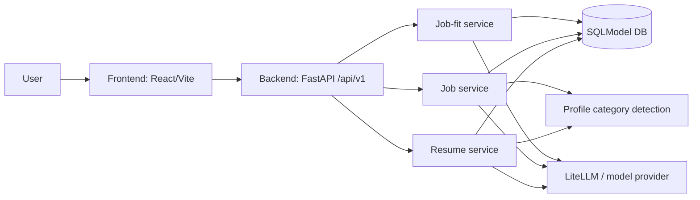

# Vitae

Vitae is an AI-assisted resume and job-fit workspace. It parses resumes and job descriptions into structured data, detects targeting criteria, compares candidate evidence against job requirements, and returns transparent fit analysis and improvement feedback.

The repository is intentionally split into a Python backend, a React frontend, and a backlog that records the broader product roadmap. Use this README as the starting point for orientation before comparing Vitae with other resume-tailoring, ATS, semantic-matching, or agentic workflow solutions.

## Objectives

Vitae aims to help a candidate or placement professional answer:

- What does this job require?
- Which resume evidence already supports those requirements?
- Which requirements are weak, missing, or underspecified?
- Which targeting criteria matter for this application, such as industry, role, seniority, company stage, geography, or special requirements?
- What concrete edits, ordering changes, and keyword/semantic improvements would improve alignment while preserving authenticity?

The current implemented core is a local web application for uploading resumes/jobs and creating job-fit analyses. The backlog extends this toward richer semantic scoring, content optimization, prompt/template selection, semantic retrieval, interactive review, and QA.

## Repository layout

```text
backend/   FastAPI service, SQLModel persistence, document parsing, LiteLLM calls, scoring/feedback services
frontend/  Vite + React single-page app for uploading resumes/jobs and viewing analyses
backlog/   Product roadmap epics and implementation notes
scripts/   Local helper scripts
.pi/       Local agent/workflow configuration
```

Local runtime artifacts may exist in working copies (`.env`, `.venv`, `node_modules`, SQLite databases, uploads, caches). Treat them as non-source artifacts unless a task explicitly says otherwise.

## Architecture at a glance



### Backend

- Entry point: `backend/src/main.py` (`src.main:app`).
- API routers: `backend/src/api/router/v1/`.
- Models: `backend/src/models/`.
- Services: `backend/src/services/`.
- Prompt templates: `backend/src/prompt/`.
- JSON schemas: `backend/schemas/json/`.
- Database: async SQLModel/SQLAlchemy via `backend/db/db.py`; default local SQLite unless `DATABASE_URL` is set.
- AI seam: LiteLLM completion/embedding calls in service utilities and category detection.

Primary resource areas:

- Resumes: upload/list/fetch/rename/delete structured resume records.
- Jobs: ingest job descriptions from URL, text, or file; list/fetch/rename/delete records.
- Job fit: create and inspect analysis, requirement mapping, feedback, skills, and scores.
- Profile categories: expose targeting category metadata for frontend selection.

### Frontend

- Entry point: `frontend/src/main.tsx` and `frontend/src/App.tsx`.
- Stack: React, Vite, TypeScript, Tailwind, Shadcn-style UI primitives.
- Local API access uses relative `/api/v1/...` URLs. Vite proxies `/api` to `http://localhost:8000`.
- Main user flow: select/upload resume → select/upload job → select targeting criteria → create/view job-fit analysis.

### Backlog and roadmap

The backlog documents intended capabilities. Do not assume a backlog item is implemented until source and tests confirm it.

Major roadmap themes:

1. Category detection and tagging.
2. Advanced semantic matching and scoring.
3. Actionable feedback and gap analysis.
4. Resume content optimization.
5. Personalized prompt and template selection.
6. Semantic search and retrieval.
7. API/frontend integration.
8. Documentation and QA.

`backlog/temple/` appears to describe a related templating/linting effort. Treat it as adjacent or exploratory until its relationship to Vitae is clarified.

## Local development

### Backend

```sh
cd backend
python3 -m venv .venv
source .venv/bin/activate
pip install -r requirements.txt
uvicorn src.main:app --reload
```

The API listens on `http://localhost:8000` by default.

Docker-oriented backend notes are in `backend/README_DOCKER.md`.

### Frontend

```sh
cd frontend
npm install
npm run dev
```

The frontend dev server proxies `/api` to the backend on port 8000.

### Validation

Use focused validation first, then broader checks:

```sh
# backend
cd backend
pytest

# frontend
cd frontend
npm run lint
npm run build
```

Some backend tests may require a live backend, model provider, embedding dependencies, or local configuration. If a test is environment-dependent, document that explicitly in the handoff.

## Standards and invariants

- Prefer TDD for code changes: add/update a focused failing test, implement the smallest fix, then refactor.
- Keep FastAPI routers thin; put parsing, persistence, LLM calls, scoring, and category detection in services.
- Keep API contracts synchronized across backend routes, frontend calls, schemas, and documentation.
- Treat resume and job content as sensitive PII. Do not add logs that print raw documents, prompts, model responses, or user secrets.
- Keep model/provider details behind service seams so local and hosted providers remain swappable.
- Use structured schemas for LLM outputs where possible and fail safely on malformed model responses.
- Use `@/*` imports and shared UI primitives in the frontend.
- Avoid committing generated artifacts, local databases, upload directories, virtual environments, caches, or `node_modules`.

## Known documentation caveats

- Some older backend/frontend documentation may refer to legacy endpoints or stale OpenAPI output. Verify current routes in `backend/src/api/router/v1/` before publishing endpoint examples.
- `NEXT-STEPS.md` and `vitae.code-workspace` currently include Temple/linter-oriented references that may not describe the main Vitae resume/job-fit product.

## Quick comparison anchors

When comparing Vitae to other solutions, use these differentiators and open questions:

- Structured resume/job parsing rather than one-shot freeform advice.
- Requirement-level mapping with evidence, gaps, and feedback.
- Targeting/profile categories as first-class context for scoring and prompts.
- Local-first development path with LiteLLM provider flexibility.
- Planned template/rendering and semantic retrieval capabilities.
- Current improvement opportunities: stronger typed API contracts, regenerated OpenAPI docs, centralized frontend API client, PII-safe logging defaults, clearer status markers in backlog, and broader automated test coverage.
