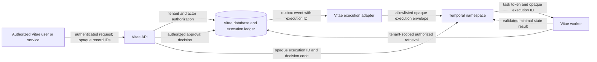

# Temporal execution boundary and threat model

## Purpose, scope, and review state

This is the WI-028 implementation boundary for [ADR-0004](../adr/0004-adopt-privacy-safe-temporal-execution-substrate.md). It applies before a Temporal client, worker, Activity, deployment, or product endpoint exists. It uses synthetic identifiers only.

The boundary has a **development-only provisional approval** from the decision owner for WI-029 contract work. It is approved as the MVP durable-execution boundary. A review failure or any PII stop condition blocks the affected work immediately; production deployment and provider selection remain blocked until role-specific review evidence and WI-040's readiness decision are complete.

## Authority and trust boundary

Vitae is the policy decision point and system of record. It owns tenant identity and authorization; canonical career records; `Workflow` and `WorkflowRun` state; promotion, evidence, and publication guards; approval decisions; and product audit/read models. Temporal owns only durable scheduling, retry, timer, cancellation, and task routing mechanics. Temporal history and visibility are not a Vitae domain store or audit source.

No arrow in this diagram carries a resume, job description, prompt, completion, secret, reviewer prose, source locator, vault path, or unbounded text. The Temporal service and worker may receive opaque IDs; sensitive retrieval occurs only through Vitae services after authorization.

UAT must not mutate canonical files or Catalog content under `~/Obsidian Vaults/loft/1 Projects/Job Search/`. Book of Work ingestion and watchers use read-only access or disposable snapshots, and write derived state only to Vitae test storage.

## Allowlisted execution envelope

Every Temporal payload, Workflow argument/result, Signal, Search Attribute, Memo, log, metric, trace attribute, diagnostic, label, fixture, and error detail must be validated against this allowlist before it is emitted.

| Field | Allowed form | Constraints |
| --- | --- | --- |
| `executionId` | opaque UUID/ULID | Required. Resolves to the Vitae `RuntimeExecution` ledger. |
| `tenantKey` | opaque tenant-scoped identifier | Required only where the adapter needs it; never display it in labels or free-form logs. |
| `workflowDefinitionId` / `workflowVersion` | approved canonical identifier/version | Required for version-pinned execution. |
| `workflowRunId` | opaque canonical ID | Optional where a run already exists. |
| `correlationId` / `idempotencyKey` | opaque identifier | Bounded length; no concatenated user, employer, filename, or content values. |
| `actorType` / `decisionCode` / `statusCode` / `diagnosticCode` | enumerated code | From a code allowlist; no free-form reason or message. |
| `attempt`, `retryCount`, `durationMs`, `recordCount`, `byteCount` | bounded integer | Counts and timing only. |
| `schemaVersion`, `activityName`, `workflowType` | deployment-controlled identifier | No tenant, profile, target, or user names. |
| `occurredAt` / `deadlineAt` | ISO-8601 timestamp | No embedded content. |

`tenantKey` and all IDs are opaque references, not authorization credentials. The API and worker must obtain authorization from Vitae state and service identity; possession of an ID never authorizes a Temporal operation or sensitive retrieval.

## Explicit denylist and stop conditions

The following are forbidden in **all** Temporal-adjacent surfaces, including serialized payloads, workflow history, Signals, Queries/Updates, Search Attributes, Memo, headers, logs, traces, metrics, labels, exceptions, diagnostics, dead-letter data, support exports, recordings, fixtures, snapshots, and test names:

- raw resume, job-description, portfolio, application, note, source, or uploaded-file content;
- filenames, document URLs, vault paths, source locators, employer/person names, contact details, or other identifying values;
- prompts, system prompts, model requests, model completions, embeddings, token streams, structured model output, or evaluation rationale;
- credentials, API keys, bearer tokens, cookies, connection strings, task tokens, encryption keys, or decrypted identifiers;
- reviewer prose, approval comments, meeting/interview notes, or free-form error text;
- any opaque identifier derived by hashing raw sensitive content unless the approved privacy review establishes its threat model and rotation/deletion behavior.

**Stop immediately** if a prohibited value is proposed, detected, or suspected. Disable the affected trigger/worker path, preserve only the minimum access-controlled incident evidence, revoke exposed credentials where applicable, assess Temporal history/observability retention and access, remove the value through the approved incident process, add a regression test, and obtain security review before resuming. Redaction after emission is not permission to continue.

## Tenant, actor, and approval controls

1. The API authorizes the requesting actor and tenant before creating an execution ledger entry or calling the adapter.
2. The ledger maps `executionId` to the authorized tenant, canonical record IDs, allowed action, and lifecycle state inside Vitae. Temporal receives no authorization grant.
3. A worker uses a workload service identity and retrieves sensitive material only through tenant-scoped Vitae services. The service verifies the ledger state, tenant ownership, action allowlist, and idempotency state on every retrieval and side effect.
4. Approval UI/API persists the actor, authorized tenant, decision code, and lifecycle transition in Vitae before it emits a minimal Temporal Signal/Update. Duplicate, stale, cross-tenant, and unauthorized decisions fail closed.
5. Status reads come from Vitae read models/ledger after actor and tenant authorization. Temporal visibility and history are not exposed as product status APIs.
6. Support and operator access is least-privilege, time-bounded, audited, and cannot bypass Vitae data authorization.

Open production-review gates: the concrete authn/authz mechanism, service-identity issuance, tenant deletion semantics, and audit-retention policy require role-specific security/privacy and backend approval before production use. The decision owner granted a provisional development-only approval for WI-029 on 2026-08-20; it does not waive these production gates.

## Namespace, queue, worker, and operator boundary

| Concern | Required boundary | Prohibited shortcut |
| --- | --- | --- |
| Namespace | One isolated namespace per deployment environment, named without tenant or career identifiers. | Tenant-specific namespaces or names derived from user/employer data. |
| Task queues | Deployment-controlled queues separated by trust/function (for example, orchestration and sensitive Activity queues). Queue names contain no tenant or document identifier. | Dynamic tenant queues or queue names carrying content. |
| Workers | Separate worker deployment/service account; least-privilege outbound access; only allowlisted configuration and structured logging. | Running workers in the API process or granting unrestricted database/object-store access. |
| Client/adapter | Only a Vitae service may start, signal, cancel, or query an execution after authorization and ledger checks. | Browser/direct client access to Temporal or a bypass around the ledger. |
| Operators | Named operational roles with environment-scoped access, break-glass procedure, audit trail, and periodic review. | Shared administrator credentials, unaudited history exports, or direct data investigation. |
| Workflow versioning | Deployment-owned workflow type/version, compatibility/replay tests, and rollback runbook. | Editing live workflow semantics without replay and rollback evidence. |

The number and exact names of queues, namespace retention settings, and worker deployment topology are deployment decisions for WI-030/WI-040, not product semantics.

## Encryption, retention, incident, and operational controls

- Use encrypted transport for every API, worker, and Temporal connection. Store secrets only in the approved secret manager; never in code, fixtures, workflow input, or logs.
- Encrypt sensitive source material only in Vitae-controlled storage. Temporal receives references and minimal metadata only. Any payload-encryption codec is defense in depth, not a waiver of the denylist.
- Define Temporal history, visibility, log, trace, metric, backup, and support-export retention separately from Vitae record retention. Deletion requests must be traceable through both systems without placing deleted content in Temporal.
- Alert on unauthorized adapter calls, cross-tenant ledger lookup failures, schema/allowlist rejection, repeated Activity idempotency conflicts, worker authentication failures, queue backlog, replay incompatibility, and any suspected PII stop condition. Alert payloads use codes and counts only.
- Incident response: contain/disable the path; preserve minimal evidence; assess access and retention surfaces; revoke/rotate secrets; reconcile affected ledger state; remediate with a regression test; obtain security sign-off before recovery. A failed execution must not retry an unsafe side effect until the ledger reconciliation decision is recorded.
- Recovery evidence before production adoption must prove worker restart, retry, cancellation, human-wait resume, duplicate delivery, replay/version compatibility, and privacy-safe diagnostics using synthetic fixtures.

## Self-hosted-first decision and Cloud migration checklist

WI-040 starts with self-hosted Temporal for MVP/UAT. Temporal Cloud remains a migration option if decision-owner, security/privacy, and operations evidence shows it is better for reliability, support, residency, or cost. The rows below are the migration/readiness checklist.

| Criterion | Required evidence |
| --- | --- |
| Data residency and jurisdiction | Deployment regions, subprocessors, metadata/history location, and legal/privacy review. |
| Access controls | SSO/RBAC, operator break-glass, audit export, service identity, and access-review evidence. |
| Encryption and key management | Transport/storage encryption, key ownership/rotation, secret-manager integration, and backup treatment. |
| Retention and deletion | History, visibility, logs, metrics, traces, backups, support exports, and deletion feasibility. |
| Network isolation | Private connectivity, egress controls, firewalling, API/worker reachability, and incident containment. |
| Reliability and recovery | SLOs, RTO/RPO, backups, restore/replay drill, regional failure behavior, and dependency limits. |
| Operational ownership | On-call staffing, upgrade/patch responsibility, runbooks, observability, support escalation, and cost ownership. |
| Scale and cost | Task volume, long waits, storage/history growth, worker capacity, egress, and budget model. |
| Exit and portability | Workflow/history export constraints, migration plan, vendor lock-in, and decommission evidence. |

## Static payload-contract test plan

WI-029 must add tests before every listed entry point is introduced. Tests construct synthetic invalid values for every denylisted category and prove the boundary rejects them before Temporal serialization or telemetry emission. Tests also prove permitted opaque envelopes survive validation without leakage.

| Entry point | Required test evidence |
| --- | --- |
| API execution trigger | Actor/tenant authorization precedes ledger creation; invalid payloads never reach adapter. |
| Execution adapter and Temporal client start/cancel/signal/query calls | Exact allowlist validation, no direct browser client, idempotency-key enforcement. |
| Workflow arguments, return values, Signals, Queries, Updates, headers, Search Attributes, and Memo | Denylisted material is rejected; only approved codes/IDs/counts/timestamps serialize. |
| Activity invocation/result and retry/error handling | Sensitive fetch stays behind Vitae authorization; errors reduce to approved code/correlation data. |
| Worker configuration and startup diagnostics | Missing or unsafe configuration fails closed without printing values. |
| Logs, traces, metrics, labels, dead-letter/retry data, and alerts | Structured allowlist and snapshot assertions prevent raw/free-form content. |
| RuntimeExecution ledger/status API/read models | Tenant isolation, actor authorization, idempotency, and safe status projection. |
| Fixtures, replay histories, test snapshots, and support/debug exports | Synthetic identifiers only; a repository scan rejects prohibited fixture patterns. |

## ADR-0004 compliance review record

| Reviewer role | Evidence expected | Status | Date / reference |
| --- | --- | --- | --- |
| Security/privacy owner | Approves data-flow, allowlist/denylist, stop conditions, retention/deletion, and Cloud/self-host criteria. | **Provisionally approved for development-only contract work** | Decision owner direction, 2026-08-20; role-specific production review remains required. |
| Backend/service owner | Confirms ledger/auth boundary, Activity retrieval pattern, and canonical-guard authority. | **Provisionally approved for development-only contract work** | Decision owner direction, 2026-08-20; role-specific production review remains required. |
| Operations owner | Confirms namespace/queue/worker/operator, incident, recovery, and operational ownership controls. | **Provisionally approved for development-only contract work** | Decision owner direction, 2026-08-20; role-specific production review remains required. |
| Decision owner | Accepts completed review evidence and authorizes WI-029 start. | **Provisionally approved for development-only contract work** | Explicit user authorization, 2026-08-20; production remains blocked pending WI-040. |

## Completion evidence

- This document is the synthetic-only threat-model, payload contract, operational-control checklist, and static test plan required by WI-028.
- ADR-0004 remains the architecture decision; WI-040 records the self-hosted-first Temporal posture with a Cloud migration option.
- WI-028 is closed for development-only contract work based on the decision-owner provisional approval above. It does not authorize a Temporal deployment, worker, client connection, or production data flow.
